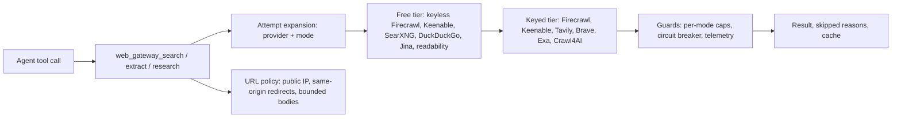
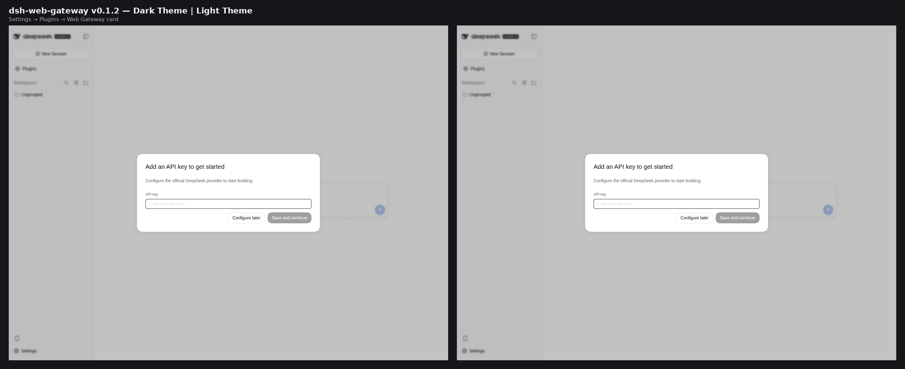

# 📦 @goodandready/dsh-web-gateway

<div align="center">

<h3>Resilient Web Search & SSRF-Safe Markdown Extract Fallback Chain for DeepSeek Harness</h3>

<p align="center">
  <a href="https://www.npmjs.com/package/@goodandready/dsh-web-gateway"></a>
  <a href="LICENSE"></a>
  <a href="https://github.com/topics/dsh-plugin"></a>
  <a href="https://nodejs.org"></a>
</p>

<p align="center">
  <a href="https://goodandready.app/"></a>
</p>

<p align="center">
  <a href="README.md"><b>🇬🇧 English</b></a> •
  <a href="README.zh.md"><b>🇨🇳 中文说明</b></a> •
  <a href="README.ru.md"><b>🇷🇺 Русский</b></a>
</p>

<table align="center">
  <tr>
    <td align="center">
      ⭐ <strong>If you like this plugin, please star it on GitHub</strong> — it shows me that the plugin is useful to you and motivates me to keep developing it.
      <br><br>
      🐛 <strong>If you find a bug or would like to request a feature</strong>, open a GitHub issue in any language — I will review your proposal and implement useful suggestions in a future plugin version.
    </td>
  </tr>
</table>

</div>

---

Resilient **web search** and **page extract** tools for [DeepSeek Harness](https://github.com/deepseek-ai/deepseek-harness).

When the built-in `web_search` / `web_fetch` tools hit rate limits, captchas, or empty results, this plugin gives the model a separate fallback chain with different tool names (no registration collisions).

Free tiers are tried before keys: Firecrawl keyless, Keenable keyless, local SearXNG, and DuckDuckGo run before any keyed provider. Every result names the exact mode (`firecrawl:free`, `firecrawl:key#2`).

## Overview / The Problem

DSH ships `web_search` and `web_fetch`, but a single upstream can rate-limit, captcha, or return an empty result. This plugin adds separate `web_gateway_*` tools with an explicit attempt model: each provider expands into free and keyed attempts, every free attempt runs before any keyed attempt, and each skip or failure is reported with its mode.

The plugin does not replace the built-in tools and does not register `web_search` / `web_fetch`. It is a fallback surface for the model, with operator-controlled provider order, caps, credentials, and diagnostics.

## Architecture



| Module | Responsibility |
|---|---|
| `lib/index.js` | Host facade: Config, tool registration, health/update route registration |
| `lib/attempts.js` | Expands a provider order into `provider:mode` attempts; free-first ordering |
| `lib/chain.js` | Fallback, race, aggregate; per-attempt timeout and run-wide deadline |
| `lib/guards.js` | Per-mode caps, circuit breaker and telemetry around each attempt |
| `lib/providers.js` | Provider HTTP calls, bounded JSON reads, screenshots, document formatting |
| `lib/url-policy.js` | URL parsing, public-IP/DNS policy, connect-time safe `undici` dispatcher |
| `lib/updater.js` | Same-origin update status/apply routes; exact-version install |
| `lib/client.js` | Settings card, health/updater blocks, `en`/`zh` locales and styles |

## Tools

| Tool | Purpose |
|---|---|
| `web_gateway_search` | Search the web. Free tier: **Firecrawl keyless → Keenable keyless → SearXNG → DuckDuckGo**; then keys: **Firecrawl → Keenable → Tavily → Brave → Exa** |
| `web_gateway_extract` | Fetch a URL as markdown. Free tier: **Firecrawl keyless → Jina → readability**; then keys: **Firecrawl → Tavily → Crawl4AI** |
| `web_gateway_research` | Search + extract top sources into a capped multi-source brief |

## HTTP API

The settings card uses two same-origin routes. Loopback requests are always allowed; remote browsers are allowed only when `Sec-Fetch-Site: same-origin` or when `Origin` and `Host` match the request host. This lets the card work through a LAN/Tailscale/reverse-proxy DSH UI without opening the routes to cross-site traffic.

| Route | Methods | Access | Purpose |
|---|---|---|---|
| `/api/dsh-web-gateway/health` | `GET`, `HEAD` | loopback or same-origin | Credential presence, local endpoint health, caps, breaker, telemetry |
| `/api/dsh-web-gateway/health` | `POST` | loopback or same-origin | Reset telemetry |
| `/api/dsh-web-gateway/update` | `GET`, `HEAD` | loopback or same-origin | Current/latest version check |
| `/api/dsh-web-gateway/update` | `POST` | loopback or same-origin + `x-dsh-plugin-update: 1` | Install the exact latest version |

A provider is skipped on missing key, empty result, HTTP 429/5xx, rate limits or network error. Built-in **Circuit Breaker** temporarily pauses providers suffering consecutive failures to avoid long timeouts. Results are cached in memory (configurable TTL). Successful responses include `provider`, `skipped` (providers not used and why), and `cached`.

## Free tier first

The plugin expands each provider into free and keyed attempts. With `freeTierFirst` (default), every free attempt runs before every keyed attempt:

1. Firecrawl keyless
2. Keenable keyless
3. SearXNG (if configured)
4. DuckDuckGo
5. Firecrawl key
6. Keenable key
7. Tavily
8. Brave
9. Exa

`freeTierFirst=false` interleaves free and keyed attempts per provider. To disable keyless entirely, set `firecrawlKeylessSearch=false`, `firecrawlKeylessFetch=false`, and `keenableEnabled=false`.

Keenable joins the default order on upgrade; set `keenableEnabled=false` to opt out.

A provider with a comma-separated credential value uses its keys in order. Authentication, rate-limit, and quota failures rotate to the next key.

Extract URLs are validated: **http/https only**, no embedded credentials, and hostnames must resolve to **public** IPs (loopback / RFC1918 / link-local / metadata blocked). The public-IP check is repeated at connect time by the `undici` dispatcher. Set `allowInternalUrls` only if you intentionally need internal targets; even then cloud providers are skipped and only local `readability` runs.

## Install

```bash
dsh plugin --profile web add @goodandready/dsh-web-gateway
```

Restart the web profile after install.

## Credentials

Add keys under **Settings → Credentials** (or `$DSH_HOME/.credentials.yaml`). The settings card stores only **credential names**, never secret values:

| Default name | Used by |
|---|---|
| `TAVILY_API_KEY` | search + extract (keyed tier) |
| `FIRECRAWL_API_KEY` | optional: keyless search/scrape works without it; a key adds its own quota |
| `KEENABLE_API_KEY` | optional: keyless search works without it; a key lifts the hourly cap |
| `EXA_API_KEY` | search |
| `BRAVE_API_KEY` | search |
| `CRAWL4AI_TOKEN` | extract (only if `crawl4aiUrl` is set) |

A credential value may contain multiple keys separated by commas; they are tried in order.

## Settings

Configure in **Settings → Plugins → Web Gateway**:

| Setting | Default | Meaning |
|---|---|---|
| `defaultLimit` | `5` | Default search result count |
| `maxLimit` | `20` | Hard search cap |
| `timeoutMs` | `30000` | Per-attempt timeout; `searchDeadlineMs` / `extractDeadlineMs` bound the whole chain |
| `cacheTtlMs` | `600000` | In-memory cache TTL (`0` disables) |
| `searxngUrl` | empty | Local SearXNG base URL; empty disables |
| `crawl4aiUrl` | empty | Crawl4AI base URL; empty disables |
| `includeDomains` / `excludeDomains` | empty | Search domain allow/deny lists |
| `freshness` | `any` | `any` / `day` / `week` / `month` |
| `diskCacheEnabled` | `true` | Persist cache under the DSH profile |
| `freeTierFirst` | `true` | All keyless attempts before any keyed attempt |
| `firecrawlKeylessSearch` | `true` | Allow keyless Firecrawl search |
| `firecrawlKeylessFetch` | `true` | Allow keyless Firecrawl extract; sends public URLs to Firecrawl cloud |
| `keenableEnabled` | `true` | Enable Keenable search (keyless, plus keyed when a key exists) |
| `keenableApiKeyEnv` | `KEENABLE_API_KEY` | Keenable credential name |
| `duckduckgoEnabled` | `true` | Enable keyless DuckDuckGo HTML search |
| `searchDeadlineMs` | `60000` | Wall-clock budget for one search chain |
| `extractDeadlineMs` | `60000` | Wall-clock budget for one extract chain |
| `circuitBreakerCooldownMs` | `300000` | How long a provider stays paused after the failure threshold |
| `dailyCap*` | `0` | Per provider+mode daily caps (`0` = unlimited, UTC day) |
| `dailyCapFirecrawlFree` / `dailyCapKeenableFree` / `dailyCapKeenable` | `0` | Free and keyed caps for the new modes |
| `dailyCapJina` / `dailyCapReadability` | `0` | Caps for the keyless extract fallbacks |
| `searchProviderOrder` | `firecrawl,keenable,searxng,duckduckgo,tavily,brave,exa` | Comma-separated search provider order |
| `extractProviderOrder` | `firecrawl,tavily,crawl4ai,jina,readability` | Comma-separated extract provider order |
| `allowInternalUrls` | `false` | Allow private/loopback extract targets (local provider only) |

## Limitations

- Local `readability` rejects PDF and DOCX with an explicit reason; Jina or Firecrawl are the document parsers. Do not expect local binary-document conversion.
- Keyless Firecrawl and Keenable receive public queries/URLs without an API key. Disable them if that egress is not acceptable.
- The settings card and its routes are same-origin; a reverse proxy must preserve `Origin` / `Host` (or `Sec-Fetch-Site`) for remote browsers.
- Screenshots are optional, requested only with `take_screenshot`, and capped at 5 MB per file.
- A provider timeout counts as a failure for the circuit breaker; repeated timeouts eventually pause that provider.

## How it relates to core DSH web tools

DeepSeek Harness already ships `web_search` and `web_fetch` via `@deepseek-ai/dsh-tool-web`. This plugin does **not** replace them. It registers `web_gateway_*` tools so the model can fall back when the built-in path fails.

## Development

```bash
npm test
npm run check
```

Tests run offline with mocked `fetch` (no live network).

## Visual verification

Plugins settings card for Web Gateway — Dark and Light themes side by side:



## License

MIT © [GooDAnDReaDY](https://github.com/GooDAnDReaDY)
