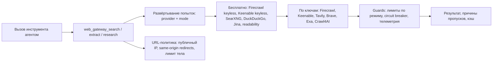

# 📦 @goodandready/dsh-web-gateway

<div align="center">

<h3>Отказоустойчивый веб-поиск и безопасное извлечение страниц (SSRF-Safe) для DeepSeek Harness</h3>

<p align="center">
  <a href="https://www.npmjs.com/package/@goodandready/dsh-web-gateway"></a>
  <a href="LICENSE"></a>
  <a href="https://github.com/topics/dsh-plugin"></a>
  <a href="https://nodejs.org"></a>
</p>

<p align="center">
  <a href="https://goodandready.app/"></a>
</p>

<p align="center">
  <a href="README.md"><b>🇬🇧 English</b></a> •
  <a href="README.zh.md"><b>🇨🇳 中文说明</b></a> •
  <a href="README.ru.md"><b>🇷🇺 Русский</b></a>
</p>

<table align="center">
  <tr>
    <td align="center">
      ⭐ <strong>Если вам нравится этот плагин, поставьте ему Star на GitHub</strong> — это покажет мне, что плагин полезен, и добавит мотивации продолжать его развитие.
      <br><br>
      🐛 <strong>Если вы нашли ошибку или хотите предложить новую функцию</strong>, откройте issue на GitHub на любом удобном языке — я регулярно просматриваю предложения и реализую полезные идеи в будущих версиях плагина.
    </td>
  </tr>
</table>

</div>

---

Устойчивые инструменты **веб-поиска** и **извлечения страниц** для [DeepSeek Harness](https://github.com/deepseek-ai/deepseek-harness).

Когда встроенные `web_search` / `web_fetch` упираются в лимиты, капчу или пустой ответ, этот плагин даёт модели отдельную запасную цепочку с другими именами инструментов (без конфликта регистрации).

## Обзор / Проблема

DSH поставляет `web_search` и `web_fetch`, но один upstream может упереться в лимит, капчу или вернуть пустой результат. Плагин добавляет отдельные `web_gateway_*` инструменты: каждый провайдер разворачивается в бесплатные и ключевые попытки, все бесплатные идут раньше ключевых, а каждый пропуск или сбой сообщается с режимом. Плагин не заменяет встроенные инструменты.

## Архитектура



| Модуль | Ответственность |
|---|---|
| `lib/index.js` | Хост-фасад: Config, регистрация инструментов и маршрутов health/update |
| `lib/attempts.js` | Разворачивает порядок провайдеров в `provider:mode`; free-first |
| `lib/chain.js` | fallback / race / aggregate; per-attempt timeout и общий дедлайн |
| `lib/guards.js` | Лимиты по режиму, circuit breaker, телеметрия |
| `lib/providers.js` | HTTP-вызовы провайдеров, bounded JSON, скриншоты, документы |
| `lib/url-policy.js` | URL/DNS-политика и connect-time `undici` dispatcher |
| `lib/updater.js` | Same-origin статус/установка обновления |
| `lib/client.js` | Карточка настроек, health/updater, en/zh локали и стили |

## Инструменты

| Инструмент | Назначение |
|---|---|
| `web_gateway_search` | Поиск. Бесплатные: **Firecrawl keyless → Keenable keyless → SearXNG → DuckDuckGo**; затем ключи: **Firecrawl → Keenable → Tavily → Brave → Exa** |
| `web_gateway_extract` | Извлечение URL в Markdown. Бесплатные: **Firecrawl keyless → Jina → readability**; затем ключи: **Firecrawl → Tavily → Crawl4AI** |
| `web_gateway_research` | Поиск + извлечение топ-источников в единый краткий дайджест |

## HTTP API

Карточка использует два same-origin маршрута. Loopback-запросы разрешены всегда; удалённый браузер — только при `Sec-Fetch-Site: same-origin` или при совпадении `Origin` и `Host`. Так карточка работает через LAN/Tailscale/reverse proxy, но не открывает маршруты для cross-site запросов.

| Маршрут | Методы | Доступ | Назначение |
|---|---|---|---|
| `/api/dsh-web-gateway/health` | `GET`, `HEAD` | loopback или same-origin | Credentials, endpoints, caps, breaker, telemetry |
| `/api/dsh-web-gateway/health` | `POST` | loopback или same-origin | Сброс телеметрии |
| `/api/dsh-web-gateway/update` | `GET`, `HEAD` | loopback или same-origin | Проверка версии |
| `/api/dsh-web-gateway/update` | `POST` | loopback или same-origin + `x-dsh-plugin-update: 1` | Установка точной версии |

Провайдер пропускается при отсутствии ключа, пустом ответе, HTTP 429/5xx или сетевой ошибке. Встроенный **Circuit Breaker** автоматически временно исключает сбоящие провайдеры на время cooldown. Результаты кэшируются в памяти (настраиваемый TTL).

## Бесплатные квоты

Сначала расходуются бесплатные каналы, затем ключи: Firecrawl keyless → Keenable keyless → SearXNG → DuckDuckGo, затем Firecrawl key → Keenable key → Tavily → Brave → Exa. Поле `provider` и `skipped` показывает режим (`firecrawl:free`, `firecrawl:key#2`).

`freeTierFirst=false` перемежает бесплатные и ключевые попытки по провайдерам. Чтобы полностью отключить keyless, задайте `firecrawlKeylessSearch=false`, `firecrawlKeylessFetch=false` и `keenableEnabled=false`.

Keenable появляется в порядке по умолчанию после обновления; отключить — `keenableEnabled=false`. Несколько ключей можно передать через запятую: при auth/rate/quota плагин переходит к следующему.

Внутренние URL при `allowInternalUrls=true` обслуживает только локальный `readability`; облачные провайдеры для них пропускаются.

URL для extract проверяются: только **http/https**, без credentials в ссылке, hostname должен резолвиться в **публичный** IP (loopback / RFC1918 / link-local / metadata по умолчанию запрещены) и повторно проверяется при соединении через `undici` dispatcher. `allowInternalUrls` включайте только осознанно.

## Установка

```bash
dsh plugin --profile web add @goodandready/dsh-web-gateway
```

После установки перезапустите web-профиль.

## Учётные данные

Ключи храните в **Настройки → Credentials** (или `$DSH_HOME/.credentials.yaml`). В карточке плагина — только **имена** credentials, не сами секреты.

`FIRECRAWL_API_KEY` и `KEENABLE_API_KEY` необязательны: keyless-режим работает без них. Значение credential может содержать несколько ключей через запятую.

## Настройки

Настройка в **Settings → Plugins → Web Gateway**:

| Параметр | По умолчанию | Значение |
|---|---|---|
| `defaultLimit` | `5` | Результатов поиска по умолчанию |
| `maxLimit` | `20` | Жёсткий предел поиска |
| `timeoutMs` | `30000` | Таймаут одной попытки; общий бюджет — `searchDeadlineMs` / `extractDeadlineMs` |
| `cacheTtlMs` | `600000` | TTL кэша в памяти (`0` отключает) |
| `searxngUrl` / `crawl4aiUrl` | пусто | Локальные endpoint-ы; пусто отключает |
| `freshness` | `any` | `any` / `day` / `week` / `month` |
| `freeTierFirst` | `true` | Все keyless-попытки до любых keyed |
| `firecrawlKeylessSearch` / `firecrawlKeylessFetch` | `true` | Разрешить keyless Firecrawl |
| `keenableEnabled` / `keenableApiKeyEnv` | `true` / `KEENABLE_API_KEY` | Keenable и имя credential |
| `duckduckgoEnabled` | `true` | Keyless DuckDuckGo |
| `searchDeadlineMs` / `extractDeadlineMs` | `60000` | Общий бюджет одной цепочки |
| `circuitBreakerCooldownMs` | `300000` | Длительность паузы после срабатывания breaker |
| `dailyCap*` | `0` | Дневные лимиты по provider+mode (`0` = без лимита) |
| `dailyCapJina` / `dailyCapReadability` | `0` | Лимиты keyless extract fallback |
| `searchProviderOrder` | `firecrawl,keenable,searxng,duckduckgo,tavily,brave,exa` | Порядок поиска |
| `extractProviderOrder` | `firecrawl,tavily,crawl4ai,jina,readability` | Порядок extract |
| `allowInternalUrls` | `false` | Разрешить внутренние URL (только локальный провайдер) |

## Ограничения

- Локальный `readability` явно отклоняет PDF/DOCX; для документов используйте Jina или Firecrawl.
- Keyless Firecrawl/Keenable отправляют публичные запросы/URL в облако; отключите, если это неприемлемо.
- Карточка и маршруты требуют same-origin; reverse proxy должен сохранять `Origin` / `Host` (или `Sec-Fetch-Site`).
- Скриншоты создаются только при `take_screenshot`, лимит файла — 5 MB.
- Таймаут провайдера считается failure для circuit breaker; повторные таймауты приостанавливают провайдера.

## Связь со штатным веб-поиском DSH

В ядре уже есть `web_search` и `web_fetch` (`@deepseek-ai/dsh-tool-web`). Этот плагин их **не заменяет**, а добавляет `web_gateway_*` как запасной путь.

## Лицензия

MIT © [GooDAnDReaDY](https://github.com/GooDAnDReaDY)
