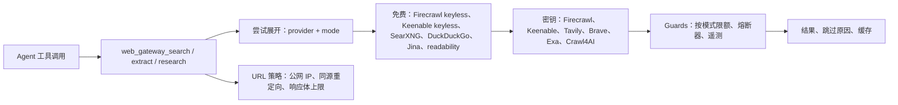

# 📦 @goodandready/dsh-web-gateway

<div align="center">

<h3>面向 DeepSeek Harness 的高可用网页搜索与 SSRF 安全页面提取回退链套件</h3>

<p align="center">
  <a href="https://www.npmjs.com/package/@goodandready/dsh-web-gateway"></a>
  <a href="LICENSE"></a>
  <a href="https://github.com/topics/dsh-plugin"></a>
  <a href="https://nodejs.org"></a>
</p>

<p align="center">
  <a href="https://goodandready.app/"></a>
</p>

<p align="center">
  <a href="README.md"><b>🇬🇧 English</b></a> •
  <a href="README.zh.md"><b>🇨🇳 中文说明</b></a> •
  <a href="README.ru.md"><b>🇷🇺 Русский</b></a>
</p>

<table align="center">
  <tr>
    <td align="center">
      ⭐ <strong>如果您喜欢这个插件，请在 GitHub 上为它点亮 Star</strong> — 这能让我知道插件对您有用，并鼓励我继续开发和维护它。
      <br><br>
      🐛 <strong>如果您发现 Bug 或希望增加功能</strong>，请使用任意语言在 GitHub 上提交 Issue — 我会评估您的建议，并在后续版本中实现有价值的改进。
    </td>
  </tr>
</table>

</div>

---

面向 [DeepSeek Harness](https://github.com/deepseek-ai/deepseek-harness) 的弹性 **网页搜索** 与 **页面提取** 工具。

当内置 `web_search` / `web_fetch` 遇到限流、验证码或空结果时，本插件提供另一套独立工具名的回退链（不会与核心工具注册冲突）。

## 概览 / 问题

DSH 自带 `web_search` / `web_fetch`，但单一上游可能限流、触发验证码或返回空结果。本插件提供独立的 `web_gateway_*` 工具：每个提供商展开为免费与密钥尝试，所有免费尝试先于密钥尝试，并逐条报告跳过/失败原因。插件不替换内置工具。

## 架构



| 模块 | 职责 |
|---|---|
| `lib/index.js` | 宿主入口：Config、工具注册、health/update 路由 |
| `lib/attempts.js` | 将提供商顺序展开为 `provider:mode` 尝试；免费优先 |
| `lib/chain.js` | fallback / race / aggregate；单次超时与总预算 |
| `lib/guards.js` | 按模式限额、熔断器、遥测 |
| `lib/providers.js` | 提供商 HTTP 调用、有界 JSON 读取、截图、文档格式化 |
| `lib/url-policy.js` | URL 解析、公网 IP/DNS 策略、连接期安全 `undici` dispatcher |
| `lib/updater.js` | 同源更新状态/安装路由 |
| `lib/client.js` | 设置卡片、health/updater、en/zh 本地化与样式 |

## 工具

| 工具 | 作用 |
|---|---|
| `web_gateway_search` | 网页搜索。免费通道：**Firecrawl keyless → Keenable keyless → SearXNG → DuckDuckGo**；然后密钥：**Firecrawl → Keenable → Tavily → Brave → Exa** |
| `web_gateway_extract` | 将 URL 提取为 Markdown。免费通道：**Firecrawl keyless → Jina → readability**；然后密钥：**Firecrawl → Tavily → Crawl4AI** |
| `web_gateway_research` | 搜索并提取多来源网页为精简 Markdown 摘要 |

## HTTP API

设置卡片使用两个同源路由。回环请求始终允许；远程浏览器仅在 `Sec-Fetch-Site: same-origin` 或 `Origin` 与 `Host` 一致时允许。这样 LAN/Tailscale/反向代理下的 UI 可用，同时拒绝跨站请求。

| 路由 | 方法 | 访问 | 用途 |
|---|---|---|---|
| `/api/dsh-web-gateway/health` | `GET`, `HEAD` | 回环或同源 | 凭证、端点、限额、熔断器、遥测 |
| `/api/dsh-web-gateway/health` | `POST` | 回环或同源 | 重置遥测 |
| `/api/dsh-web-gateway/update` | `GET`, `HEAD` | 回环或同源 | 版本检查 |
| `/api/dsh-web-gateway/update` | `POST` | 回环或同源 + `x-dsh-plugin-update: 1` | 安装精确版本 |

缺少密钥、空结果、HTTP 429/5xx 或网络错误时会跳过该提供商。内置**熔断器 (Circuit Breaker)** 会在多次连续失败后自动暂时隔离该提供商。结果可按 TTL 缓存在内存中。

## 免费额度优先

先消耗免费通道，再使用密钥：Firecrawl keyless → Keenable keyless → SearXNG → DuckDuckGo，然后 Firecrawl key → Keenable key → Tavily → Brave → Exa。`provider` 和 `skipped` 会显示模式（`firecrawl:free`、`firecrawl:key#2`）。

`freeTierFirst=false` 会按提供商交错免费与密钥尝试。要完全关闭 keyless，请设置 `firecrawlKeylessSearch=false`、`firecrawlKeylessFetch=false`、`keenableEnabled=false`。

升级后 Keenable 会加入默认顺序；设置 `keenableEnabled=false` 可退出。多个密钥可用逗号分隔，认证/限流/额度失败时会轮换。

当 `allowInternalUrls=true` 时，内网 URL 只由本地 `readability` 处理，云提供商会被跳过。

提取 URL 会校验：仅 **http/https**，禁止 URL 内嵌凭据，主机名必须解析为 **公网** IP（回环 / RFC1918 / 链路本地 / 元数据地址默认拦截），并在连接时由 `undici` dispatcher 再次校验。仅在确实需要时才打开 `allowInternalUrls`。

## 安装

```bash
dsh plugin --profile web add @goodandready/dsh-web-gateway
```

安装后请重启 web 配置文件。

## 凭证

在 **设置 → 凭证**（或 `$DSH_HOME/.credentials.yaml`）中保存密钥。设置卡片只保存 **凭证名称**，不保存密钥本身。

`FIRECRAWL_API_KEY` 和 `KEENABLE_API_KEY` 可选：keyless 模式无需密钥。凭证值可包含多个以逗号分隔的密钥。

## 设置

在 **设置 → 插件 → Web Gateway** 中配置：

| 设置 | 默认值 | 含义 |
|---|---|---|
| `defaultLimit` | `5` | 默认搜索结果数 |
| `maxLimit` | `20` | 搜索硬上限 |
| `timeoutMs` | `30000` | 单次尝试超时；整条链预算由 `searchDeadlineMs` / `extractDeadlineMs` 控制 |
| `cacheTtlMs` | `600000` | 内存缓存 TTL（`0` 禁用） |
| `searxngUrl` / `crawl4aiUrl` | 空 | 本地端点；空则禁用 |
| `freshness` | `any` | `any` / `day` / `week` / `month` |
| `freeTierFirst` | `true` | 所有无密钥尝试先于密钥尝试 |
| `firecrawlKeylessSearch` / `firecrawlKeylessFetch` | `true` | 允许无密钥 Firecrawl 搜索/提取 |
| `keenableEnabled` / `keenableApiKeyEnv` | `true` / `KEENABLE_API_KEY` | Keenable 开关与凭证名 |
| `duckduckgoEnabled` | `true` | 启用无密钥 DuckDuckGo |
| `searchDeadlineMs` / `extractDeadlineMs` | `60000` | 单条链的总预算 |
| `circuitBreakerCooldownMs` | `300000` | 熔断后的冷却时长 |
| `dailyCap*` | `0` | 按 provider+mode 的日限额（`0` = 不限） |
| `dailyCapJina` / `dailyCapReadability` | `0` | 无密钥提取回退的日限额 |
| `searchProviderOrder` | `firecrawl,keenable,searxng,duckduckgo,tavily,brave,exa` | 搜索提供商顺序 |
| `extractProviderOrder` | `firecrawl,tavily,crawl4ai,jina,readability` | 提取提供商顺序 |
| `allowInternalUrls` | `false` | 允许内网提取（仅本地提供商） |

## 限制

- 本地 `readability` 会明确拒绝 PDF/DOCX；文档解析请使用 Jina 或 Firecrawl。
- 无密钥 Firecrawl / Keenable 会把公网查询/URL 发送到云端；如不接受请关闭。
- 设置卡片与路由要求同源；反向代理必须保留 `Origin` / `Host`（或 `Sec-Fetch-Site`）。
- 截图仅在 `take_screenshot` 时生成，单文件上限 5 MB。
- 提供商超时会计入熔断器失败；连续超时会暂停该提供商。

## 与核心网页工具的关系

Harness 已通过 `@deepseek-ai/dsh-tool-web` 提供 `web_search` / `web_fetch`。本插件 **不替换** 它们，只额外提供 `web_gateway_*` 作为回退。

## 许可证

MIT © [GooDAnDReaDY](https://github.com/GooDAnDReaDY)
